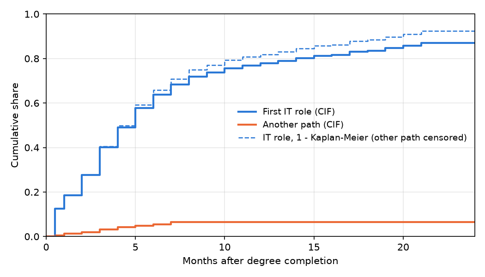

# Competing risks: IT role vs another path

_Generated by `python -m core.competing` - do not edit by hand._

635 graduates: 467 found a first IT role, 37 started another path first (non-IT job, self-employment or further studies, with the month from Q16a), 131 were still looking at the survey. 13 graduates on another path did not give the month and are treated as still looking, as in the main analysis.

## Share who had reached each outcome

| Months | IT role (cumulative incidence) | IT role (1 - Kaplan-Meier) | Another path (cumulative incidence) |
|---|---|---|---|
| 3 | 40.0% | 40.5% | 3.1% |
| 6 | 63.7% | 65.8% | 5.4% |
| 12 | 77.8% | 81.9% | 6.5% |
| 24 | 87.0% | 92.4% | 6.5% |

1 - Kaplan-Meier answers 'what share would find IT work if nobody took another path'; the cumulative incidence answers 'what share actually found IT work first'. The gap shows how much the competing path matters.

## Cause-specific hazard ratios (95% CI)

HR > 1: associated with reaching that outcome sooner (numeric features per one SD of the training data). The IT-role model treats another path as censored, like the main model, but also includes graduates in further studies who gave a start month.

| Feature | Main model (IT role) | Cause-specific: IT role | Cause-specific: another path |
|---|---|---|---|
| GPA | 1.24 (1.10-1.40) | 1.31 (1.16-1.48) | 1.25 (0.80-1.96) |
| internship experience | 1.12 (1.03-1.23) | 1.13 (1.03-1.24) | 0.94 (0.66-1.33) |
| professional certifications | 1.09 (1.00-1.19) | 1.07 (0.97-1.17) | 0.86 (0.58-1.26) |
| personal / academic projects | 1.07 (0.95-1.20) | 1.09 (0.97-1.23) | 0.94 (0.61-1.45) |
| technical skill ratings | 1.13 (0.98-1.31) | 1.07 (0.92-1.25) | 0.66 (0.39-1.12) |
| soft skill ratings | 0.98 (0.87-1.12) | 1.04 (0.92-1.18) | 1.61 (1.05-2.46) |
| a portfolio (GitHub / website) | 1.02 (0.92-1.13) | 1.00 (0.90-1.11) | 0.96 (0.67-1.39) |
| early preparation for IT jobs | 1.01 (0.92-1.11) | 1.01 (0.92-1.11) | 0.88 (0.62-1.24) |
| self-learning during the degree | 1.01 (0.90-1.13) | 0.96 (0.86-1.08) | 0.98 (0.65-1.46) |
| hackathons and competitions | 1.01 (0.91-1.11) | 1.03 (0.93-1.14) | 1.05 (0.71-1.54) |
| open-source contribution | 0.93 (0.85-1.03) | 0.92 (0.84-1.02) | 0.90 (0.61-1.34) |
| familiarity with software development practices | 0.94 (0.84-1.06) | 0.95 (0.84-1.07) | 0.95 (0.62-1.45) |
| degree programme: IT / Information Systems | 1.12 (0.91-1.38) | 1.15 (0.93-1.42) | 1.12 (0.52-2.39) |
| degree programme: specialised (Cyber Security, Data Science, AI/ML or other) | 1.06 (0.83-1.35) | 1.12 (0.88-1.43) | 1.40 (0.61-3.22) |
| type of institution: non-state institutes | 1.14 (0.88-1.47) | 1.10 (0.85-1.42) | 0.82 (0.32-2.08) |
| type of institution: foreign-affiliated institutes | 1.03 (0.83-1.27) | 1.00 (0.81-1.24) | 0.87 (0.42-1.83) |

**The 'another path' model has 2.3 events per parameter (below 10): treat it as exploratory.**

Cause-specific hazard ratios describe the rate of each outcome among graduates who have reached neither yet. They are associations, not effects of the features.
