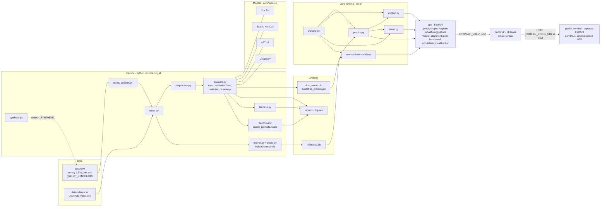

# Architecture

## Components

**Data**
- `data/raw/` - original CSVs, never modified by code; a real file always wins over a `*_SYNTHETIC` one.
- `data/reference/university_types.csv` - maps institution names to state / non-state / foreign-affiliated.

**Pipeline** (`python -m core.run_all`)
- `core/schema.py` - single source of truth for fields, item numbers, skills, model and actionable features.
- `core/import_responses.py` - converts the main-study response workbooks (`New Data/Main data/*.xlsx`) into `data/raw/graduate_responses.csv` and `employer_responses.csv`, with one reference survey date.
- `core/synthetic.py` - generates labelled fake data from a Weibull model with known, documented effects.
- `core/forms_adapter.py` - turns a raw Google Forms export into the schema format by question number.
- `core/clean.py` - validates, deduplicates, builds duration/event for graduates only, writes the cleaning log.
- `core/preprocess.py` - derived fields, skill block means, imputation, scaling, encoding; fitted on training folds only.
- `core/splits.py` - fixed train / validation / test split; every graduate has exactly one role (no data reuse).
- `core/evaluate.py` - fit on train, compare on validation, selection rule, final fit on train, one evaluation on the locked test set, bootstrap.
- `core/feature_sets.py` - compares the core and extended predictor sets on the same folds with a pre-registered rule (report only).
- `core/fairness.py` - out-of-fold performance by gender and university type (backend report only).
- `core/market.py` + `core/peers.py` - build `reference.db`: skill demand and Kaplan-Meier peer medians.
- `benchmark/` - exports held-out profiles as LLM prompts, optionally sends them to an LLM API (`run_llm.py`), and scores the answers with the same metrics.

**Models** (`core/models/`) - one shared interface (fit, risk, survival curve):
- Cox PH (lifelines), Elastic Net Cox (scikit-survival), AFT Weibull / log-normal / log-logistic (lifelines), DeepSurv (pycox).

**Artifacts**
- `artifacts/final_model.pkl`, `bootstrap_models.pkl` - selected model + 200 resampled refits (uncertainty).
- `data/reference/reference.db` - SQLite; employer requirements, job ads, skill demand, peer stats; no graduate-level data.
- `artifacts/*.md`, `artifacts/figures/` - model comparison, fairness and benchmark reports, thesis figures.

**Core runtime** (loaded once by the API)
- `core/predict.py` - survival curve -> typical range, median, bootstrap interval, confidence label; conditional on months already searched for graduates still looking.
- `core/explain.py` - global hazard / time ratios and per-profile top-3 helping / hurting (actionable features only).
- `core/whatif.py` - re-predicts after changes to actionable features only, with range checks and cautions.
- `core/market.py` (`ReferenceData`) - skill gaps and peer benchmarks read from `reference.db`.
- `core/pathways.py` - compares self-rated skills with skill prevalence by role in the job-ad study; this is descriptive guidance, not a hiring prediction.
- `core/wording.py` - every user-facing sentence, associational and jargon-free.

**Serving**
- `core/chat.py` - grounded assistant: matches a question to a fixed set of intents; general questions about the model, privacy, reliability and population-level factors work without a profile, while personalized prediction, explanation, what-if, suggestion, market and peer answers require one; no language model, nothing stored.
- `api/` - FastAPI; Pydantic schemas generated from `core/schema.py`; no logic, no storage, no auth.
- `api/report.py` - builds a one-time PDF report in memory; `/report` returns the bytes without writing to disk.
- `profile_service/` - a separate optional FastAPI service and SQLite database for account identity (display name and a fixed-set emoji avatar), profile snapshots (answers, prediction, explanation, suggestions, employer alignment, role recommendations, selected career path and active what-if comparisons), career goals and action progress. It is isolated from `api.main`; phone OTP uses separately configured SMS provider credentials and rate-limited, expiring challenges.
- `frontend/` - Streamlit app pages, including role-fit exploration based on the job-ad study; calls the prediction API and optional progress service without storing profile data inside the prediction backend.
